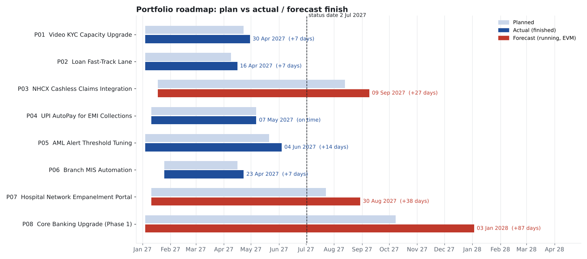
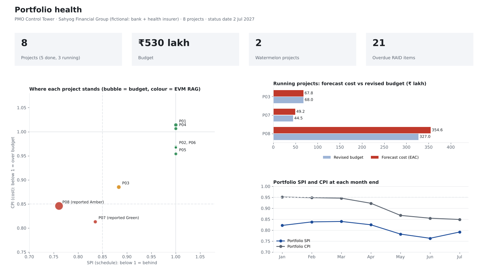
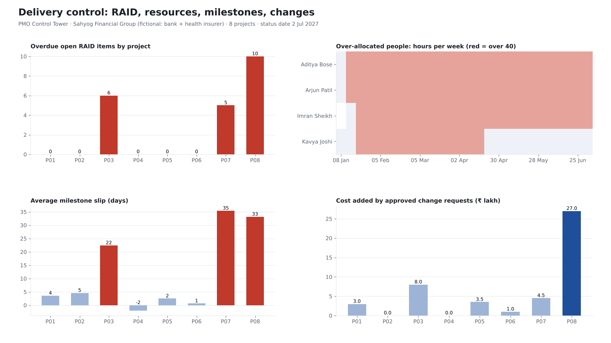

# 04_powerbi

| Page | Question | Visuals |
| --- | --- | --- |
| 1. Portfolio health | Which projects are really in trouble? | Cards (projects, budget, watermelons, overdue RAID); SPI vs CPI scatter (bubble = budget, colour = EVM RAG, label shows reported RAG); forecast cost vs revised budget; monthly portfolio SPI / CPI |
| Roadmap (add as a third page or in Page 1) | Which projects finished late, and when will the running ones finish? | Gantt-style bars: planned dates vs actual finish (done) or EVM forecast finish (running), with a status-date line |
| 2. Delivery control | What needs action this week? | Overdue RAID by project; over-allocation heatmap; milestone slip; cost added by approved changes |

[`DAX_measures.md`](DAX_measures.md) has the model, measures and expected values.

> Previews are drawn from the same data and match the Excel and SQL results. The `.pbix` will be added once built in Power BI Desktop.
