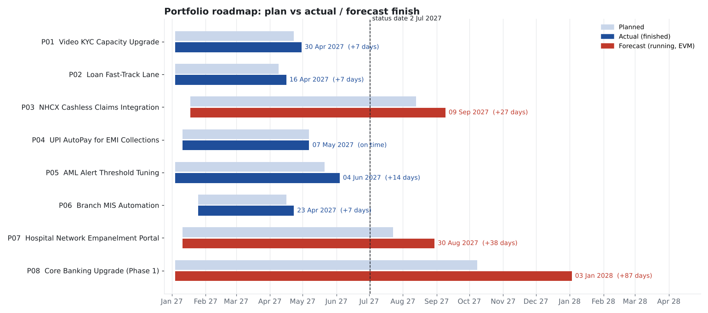

# 2. Portfolio status report: week ending 2 July 2027

**To:** COO office · **From:** PMO · **Portfolio:** 8 projects, Rs 530 lakh (Rs 577 lakh after approved changes)

## Summary: AMBER

Five projects are finished; three are still running and all three are behind. **Two projects are reported better than their numbers show** (P07 reported Green, P08 reported Amber; both are Red on EVM). The portfolio is forecast to cost **Rs 603.0 lakh vs a revised budget of Rs 577 lakh** (Rs 26.0 lakh over), almost all from P08.

| Project | % done | SPI | CPI | Reported | EVM RAG | Forecast cost vs revised budget (Rs lakh) | Note |
| --- | --- | --- | --- | --- | --- | --- | --- |
| P03 NHCX Cashless Claims Integration | 79% | 0.88 | 0.89 | Amber | Amber | 67.8 vs 68.0 | Hospital pilot late |
| P07 Hospital Network Empanelment Portal | 81% | 0.83 | 0.81 | Green | **Red** | 49.2 vs 44.5 | **Watermelon**; UAT late |
| P08 Core Banking Upgrade (Phase 1) | 55% | 0.76 | 0.85 | Amber | **Red** | 354.6 vs 327.0 | **Watermelon**; forecast finish Jan 2028 vs Oct 2027 |

Finished: P01, P02, P04, P05, P06. Four of five finished 7-14 days late; final costs were within -1.4% to +4.8% of budget.

## Needs attention

1. **RAID hygiene:** 21 open items are past their due date, all on P03, P07 and P08 (average 51-71 days overdue).
2. **People:** 4 people are booked over 40 hours a week: Arjun Patil (BA) and Aditya Bose (QA) for 25 weeks, Imran Sheikh (developer) for 24 weeks (peak 51 h), Kavya Joshi (BA) for 13 weeks. Three of them are split between two troubled projects; Kavya Joshi is split between P02 and P03.
3. **Updates:** 10 weekly updates were not sent; 9 of them were for P03, P07 and P08.
4. **Milestones:** 7 of 31 completed milestones were on time; 2 are late and 5 at risk, all on the three running projects.

## Decisions requested from the steering committee

See [03_steering_committee_pack.md](03_steering_committee_pack.md).
