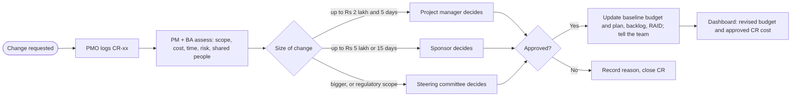

# 4. Change control process

Source: [`change_control_flow.mmd`](change_control_flow.mmd)

1. **Raise:** anyone fills a change request: what, why, who asked.
2. **Log:** PMO gives it an ID (CR-xx) and adds it to the change log.
3. **Assess:** PM and BA estimate impact on scope, cost, schedule, risk and other projects (shared people).
4. **Decide:** by threshold (see [01_pmo_governance.md](01_pmo_governance.md)): PM, sponsor or steering committee.
5. **Update:** if approved, update the baseline budget and schedule, the backlog and the RAID log; tell the team.
6. **Track:** the dashboard shows approved cost by project and the revised budget.

## The 14 change requests so far

| Decision | Count | Cost impact |
| --- | --- | --- |
| Approved | 8 | Rs 47.0 lakh added (8.9% of the original budget) |
| Rejected | 3 | Rs 24.5 lakh avoided |
| Pending | 3 | Rs 4.0 lakh, Rs 9.0 lakh, and a Rs 40 lakh saving |

Largest share: P08, Rs 27 lakh approved (9% of its budget).
