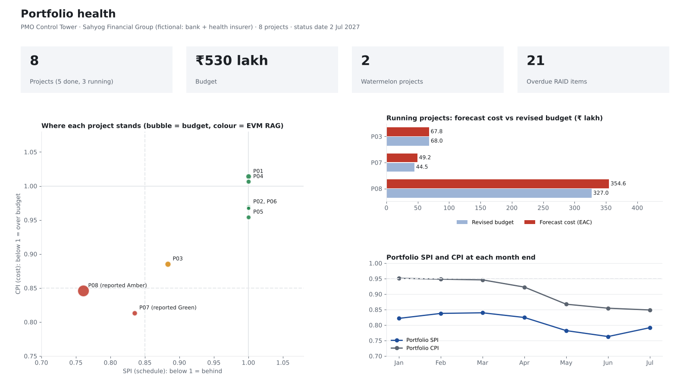

# PMO Control Tower: Project Portfolio Tracking for a Bank & Health Insurer

> Project management / PMO case study on **synthetic data**. Sahyog Financial Group, its people and projects are fictional.

## The situation

Sahyog Financial Group (a bank and a health insurer) runs **8 change projects worth Rs 530 lakh**: Video KYC, a loan fast-track lane, NHCX cashless claims, UPI AutoPay, AML alert tuning, branch MIS, a hospital empanelment portal and a core banking upgrade. Every week each project manager sends a status update. As the PMO analyst, the job is to turn 26 weeks of updates into one honest view: **which projects are really in trouble, why, and what the steering committee should decide.**

## Key findings (status date 2 Jul 2027)

1. **2 "watermelon" projects:** green outside, red inside. P07 (hospital portal) was reported **Green** but runs at **SPI 0.83 / CPI 0.81**; P08 (core banking) was reported **Amber** at **SPI 0.76 / CPI 0.85**. Both are Red on the PMO's EVM rule.
2. **Portfolio forecast Rs 603.0 lakh vs Rs 577 lakh revised budget** (Rs 26 lakh over), almost all from P08: forecast **Rs 354.6 lakh vs Rs 327 lakh**, finishing **Jan 2028 instead of Oct 2027**.
3. **5 projects finished**; 4 of them 7-14 days late, all within -1.4% to +4.8% of budget.
4. **21 RAID items overdue**, all on the three running projects, 51-71 days overdue on average.
5. **4 people over 40 hours a week** for 13-25 weeks (peak 51 h), all booked on the troubled projects.
6. **10 weekly updates missing**; 9 came from the three troubled projects, an early warning the PMO can act on.
7. **14 change requests:** 8 approved added Rs 47 lakh (8.9% of budget); a descope on P02 protected its go-live.

## What the PMO recommended

| Project | Recommendation |
| --- | --- |
| P08 Core Banking | Approve CR-13 (move loan module to phase 2: saves ~Rs 40 lakh and ~30 days) + weekly vendor performance review; free two shared people for P08 only |
| P07 Hospital Portal | Re-baseline honestly (mid-September, Rs 49.2 lakh), reject the Rs 9 lakh registry add-on for phase 1, report EVM numbers weekly |
| Portfolio | RAG must follow the EVM rule; missed updates treated as early warnings; check the resource heatmap before approving new work |

## What's in this repo

| Folder | Contents |
| --- | --- |
| [`01_data`](01_data) | 7 CSVs: projects, weekly status (PV / EV / AC), milestones, RAID log, change requests, resource allocation, sprints + data dictionary |
| [`02_excel`](02_excel) | Formula-driven PMO workbook: portfolio dashboard with EVM, watermelon flag, EAC / VAC, resource heatmap |
| [`03_sql`](03_sql) | PostgreSQL schema, load script, 12 PMO queries and results |
| [`04_powerbi`](04_powerbi) | 2-page dashboard design, DAX measures, previews |
| [`05_pm_docs`](05_pm_docs) | PMO governance, portfolio status report, steering committee pack, change control process, lessons learned, fresher vs mid-level skills map |
| [`scripts`](scripts) | Data generator, Excel builder, dashboard preview |
| [`BUILD_GUIDE.md`](BUILD_GUIDE.md) | Step-by-step build of the Excel, SQL and Power BI parts |

## Skills shown

**PMO / fresher level:** status tracking, RAID management, chasing missing updates, data-quality checks, Excel dashboards, steering pack preparation, Agile sprint metrics.
**Project manager / mid level:** earned value (SPI, CPI, EAC, VAC), forecasting, change control, resource management, recovery options for Red projects, lessons learned. Full map: [06_skills_map.md](05_pm_docs/06_skills_map.md).

## Tools

Excel · PostgreSQL · Power BI (DAX) · Agile sprint data (Jira-style)

## Author

Salil Gokhale · [LinkedIn](https://www.linkedin.com/in/salil-gokhale-analytics) · [GitHub](https://github.com/Salil360-cyber)
